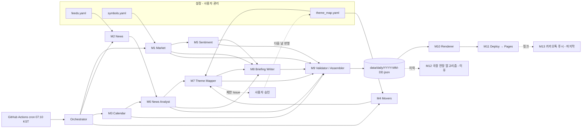

# Architecture — Daily US Market & Macro Radar (확정본 v1, 2026-11-05)

## 1. 목표
매 국장 영업일 아침, 밤사이 미 증시(지수 현물·선물, VIX, 금리, 환율)·매크로 일정·뉴스를 자동 수집·요약하고
미 주도 종목 ↔ 국내 수혜주 매핑을 모바일 웹 1장으로 제공한다. 국장 전망 알고리즘과 카카오톡 푸시는 이후 단계.

## 2. 확정 결정 사항
| 항목 | 결정 |
|---|---|
| 개발/실행 | GitHub(공개 repo 1개) + Claude Code로 신규 구축, GitHub Actions cron |
| 실행 시각 | 07:10 KST 시작(cron `10 22 * * 0-4` UTC), 07:30 전 게시 목표, 재갱신 없음 |
| 지표 6종 (7값) | NDX 현물, SPX 현물, 지수선물(NQ·ES), VIX, 미10년물, 원/달러 — 하나라도 누락 시 실패 기록 |
| 나스닥 기준 | 나스닥100으로 통일(^NDX, NQ=F) |
| 데이터 소스 | 무료: yfinance(주), FRED(금리 폴백), 영어 뉴스 RSS, Forex Factory 캘린더 JSON |
| 키움 REST API | 제외 |
| 경제 캘린더 | ① Forex Factory 공개 JSON ② 실제치는 뉴스에서 LLM 보완 ③ 인베스팅닷컴은 기본 경로 아님 |
| 공포/탐욕 | VIX 단독 → 0~100 (규칙은 M12 협의 시 확정, 임시 규칙 사용) |
| LLM | OpenAI: 분석 gpt-4o-mini, 브리핑 gpt-5.5 (모델명 설정 파일화) |
| 테마 매핑 | 수동 YAML이 기준. 신규는 LLM 제안 → GitHub Issue → 사용자 승인 → 다음 날 반영 |
| UI | 모바일 웹(정적 HTML, 서버 사이드 렌더링), 실데이터만, 시뮬레이션 제어 없음, 면책 문구 고정 |
| UI 기준 디자인 | Codex 시안 `morning-radar.html` (밝은 테마, 상승 빨강/하락 파랑, 8카드, Hero 3포인트, 오늘 밤 체크포인트) — v1.1 반영 |
| 참고 지표 | 필라델피아 반도체(SOX) 카드 추가, 필수 6종에는 미포함 |
| 공유 | Open Graph 미리보기(카톡), `noindex` 검색 노출 차단, 날짜·요일 헤더 필수 |
| 게시 | GitHub Pages(공개), 지인 링크 공유 |
| 휴장일 | 국장 휴장 → 생성 생략 / 미장 휴장·국장 개장 → 직전 미장 데이터 + "미장 휴장" 표시 |
| 1차 버전 국장 영향 | 방향성 코멘트만, 갭 % 범위 수치 미표시 |

## 3. 모듈 및 화면 매핑 (UI 시안 기준)
| 화면 섹션 | 모듈 |
|---|---|
| Hero (헤드라인 + 3포인트 + 먼저 볼 것) | M8 |
| 시장 심리 & 오늘 국장은? | M5, M8 |
| 시장 지표 8카드 (필수 7 + SOX) | M1 |
| 흐름을 만든 뉴스 | M6 |
| 미국 주도주, 국내 연결 | M4 + M7 |
| 다음 체크포인트 / 어젯밤 지표 결과 | M3 (+M6 실제치 보완) |
| 상태 배너 / 데이터 상태 dialog | M9 |

역할 경계는 `CLAUDE.md` §3 참조.

## 4. 의존성 (실행 흐름 단방향 DAG)

## 5. 리스크 요약
- **최대 리스크**: Yahoo의 클라우드 IP 간헐 차단 → 6종 누락. P5 안정화 2주간 성공률 측정 후 대체 소스 결정.
- Forex Factory JSON 실제치(actual) 필드 포함 여부 구현 시 확인.
- LLM 토큰: 일 예상 4o-mini ~30만 / 5.5 ~2만 토큰 → 한도 대비 충분.
- LLM 환각 숫자: M9 숫자 근거 검증으로 차단.
