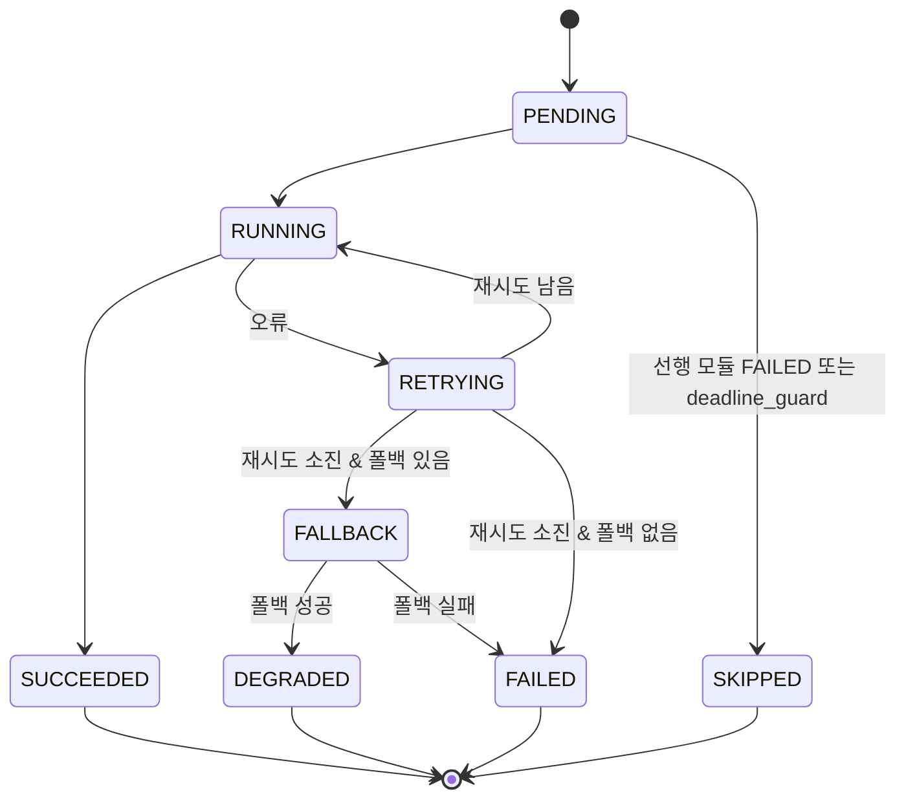

# Task Orchestration Spec

## 1. 라우팅 방식: 규칙 기반 고정 파이프라인
| 판단 기준 | 규칙 기반 | LLM 기반 | 하이브리드 |
|---|---|---|---|
| 입력 유형이 매일 동일한가 | ✅ 동일 | | |
| 분기 조건이 명확한가(휴장일, 실패) | ✅ | | |
| 실행 재현성·비용 | ✅ 최고 | 낮음 | 중간 |

→ **LLM 라우터를 두지 않는다.** Orchestrator는 고정 DAG를 실행하며, LLM은 M6·M7(제안)·M8 내부 작업에만 사용한다.
분기는 다음 3가지뿐이다.
1. 국장 휴장 → `SKIPPED_HOLIDAY` 종료
2. 미장 휴장(국장 개장) → 수집 기준일을 직전 미장 거래일로, 화면에 "미장 휴장" 배지
3. 모듈 실패 → 아래 재시도/폴백 정책

휴장일 판정: `exchange_calendars`의 `XKRX`(국장), `XNYS`(미장). 실행 기준일 `run_date` = KST 날짜.
미장 기준 세션 = `run_date` 이전 가장 최근 XNYS 세션.

## 2. 실행 단계 (Stage)
| Stage | 모듈 | 병렬 | 타임아웃 | Critical |
|---|---|---|---|---|
| S0 | 휴장일 판정 | - | 30s | ✅ |
| S1 | M1, M2, M3, M4 | 병렬 (thread pool 4) | 각 120s | M1만 ✅ |
| S2 | M5, M6 | 병렬 | M5 30s / M6 300s | - |
| S3 | M7 | - | 120s | - |
| S4 | M8 | - | 120s | - |
| S5 | M9 | - | 30s | ✅ |
| S6 | M10 | - | 60s | ✅ |
| S7 | M11 (workflow step) | - | 300s | ✅ |

전체 목표 10분 이내. 07:28 KST까지 S6 미완료 시 남은 비필수 단계(M7 제안, M8)를 건너뛰고 S5로 진행(`deadline_guard`).

## 3. 상태 머신

### 3.1 모듈 상태


### 3.2 실행(Run) 상태
| Run 상태 | 조건 | 결과 |
|---|---|---|
| `SKIPPED_HOLIDAY` | 국장 휴장 | 게시 없음 |
| `OK` | 모든 모듈 SUCCEEDED | 게시 |
| `DEGRADED` | Critical 성공, 일부 DEGRADED/FAILED/SKIPPED | 게시 + 해당 섹션 "데이터 없음/요약 없음" |
| `FAILED_INDICATORS` | 필수 6종(7값, `required: true`) 중 누락 ≥1 (SOX 누락은 DEGRADED) | 게시(누락 회색 표시) + Actions 실패 처리 → 메일 |
| `FAILED` | M9/M10/M11 실패 | 전일 페이지 유지 + 경고 배너 커밋 시도 + 메일 |

성공 기준 판정은 `OK` 또는 `DEGRADED`.

## 4. 재시도 · 폴백 정책
| 모듈 | 재시도 | 백오프 | 폴백 | 최종 |
|---|---|---|---|---|
| M1 지수/선물/VIX/환율 | 3 | 2s·4s·8s + 지터 | 티커별 대체(`symbols.yaml`의 `fallback`) | 값 `null` + `missing` |
| M1 미10년물 | 3 | 동일 | FRED `DGS10` (전일치, `stale: true`) | `null` |
| M2 RSS | 소스별 2 | 2s | 나머지 소스로 진행 | 20건 미만 시 경고 |
| M3 캘린더 | 2 | 4s | M6에 "캘린더 없음" 전달, 실제치는 뉴스에서 추출 | 섹션 "미수집" |
| M4 movers | 2 | 2s | 실패 종목만 제외 | 섹션 축소 |
| M5 | 0 | - | - | 섹션 "산출 불가" |
| M6 배치 | 1 (스키마 오류/5xx/429) | 429는 `retry-after` 준수 | 해당 배치 건너뜀 | 제목만 카드 표시 |
| M7 제안 | 1 | - | 제안 생략(매핑은 YAML만으로 진행) | - |
| M8 | 1 | - | gpt-5.5 → gpt-4o-mini → 템플릿 문구 | 템플릿 |
| M8 숫자 검증 실패 | 0 | - | 템플릿 문구 | - |
| M11 게시 | 1 | 30s | - | 메일, 전일 페이지 유지 |

공통: 429(Rate limit)·5xx·타임아웃만 재시도. 4xx(인증 등)는 즉시 FAILED.

## 5. LLM 예산 가드
`config/settings.yaml` → `llm_budget: {gpt-4o-mini: 2_000_000, gpt-5.5: 200_000}` (일 토큰).
OpenAI 응답의 usage를 누적, 초과 예상 시 이후 호출을 폴백 경로로 전환. 실사용량은 run log에 기록.

## 6. 멱등성 · 수동 실행
- 같은 `run_date` 재실행은 `data/*/YYYY-MM-DD*` 덮어쓰기(멱등).
- `workflow_dispatch` 입력: `run_date`(기본 오늘), `skip_llm`(bool), `force`(휴장일 무시).
- 로컬: `python -m radar.run_daily --date YYYY-MM-DD [--dry-run] [--no-llm] [--no-deploy]`.

## 7. Run Log 형식 (`data/logs/YYYY-MM-DD.run.json`)
```json
{
  "run_date": "2026-11-05",
  "us_session": "2026-11-04",
  "started_at": "2026-11-04T22:10:03Z",
  "finished_at": "2026-11-04T22:16:41Z",
  "run_status": "DEGRADED",
  "modules": {
    "M1": {"status": "SUCCEEDED", "attempts": 1, "duration_s": 4.2, "notes": []},
    "M3": {"status": "FAILED", "attempts": 3, "error": "HTTP 403", "notes": ["calendar missing"]}
  },
  "indicators_missing": [],
  "llm_usage": {"gpt-4o-mini": 287000, "gpt-5.5": 18400}
}
```
P5 안정화 기간에는 이 로그를 집계해 모듈별 성공률을 산출한다.

## 8. GitHub Issue 제안 흐름 (M7)
1. 미매핑 미국 종목(등락률 상위 & 뉴스 언급)에 대해 LLM 제안 생성
2. 제안 종목 코드를 KRX 상장 목록(FinanceDataReader)과 대조, 없으면 제거
3. `data/proposals/YYYY-MM-DD.json` 저장 + Issue 1건 생성(라벨 `theme-proposal`, 동일 티커 열린 Issue 있으면 코멘트만 추가)
4. 사용자가 YAML 반영 후 Issue close → 다음 실행부터 적용
